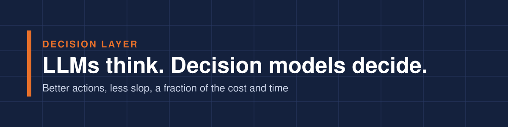

<p align="center"></p>

Language models are good at reading, drafting and reasoning. They are also slow, expensive, and sure of themselves when they shouldn't be. Put one alone in charge of a real business action and you get slop: confident letters that promise the wrong thing, summaries with facts the source never said, and agents that keep going when they should stop.

Decision models are the other half. Jev from TypeSafe, and now similar models from OpenAI, Microsoft and others, write nothing. They answer narrow questions you define, with a probability, in milliseconds and for fractions of a cent.

**Used together, they turn AI output into action you can trust.** The LLM does the thinking and drafting. The decision model checks, ranks and routes what the LLM produced, and rules you can read decide what happens next. The result:

- **Less slop.** Every draft, fact or step is checked before anyone acts on it.
- **More legitimate outcomes.** Each action traces to named questions, a score and a rule you can show a customer, an examiner or your board.
- **Faster to the right action.** Checks take milliseconds, so good work moves at once and only real doubt waits for a person.
- **A fraction of the cost.** A check costs fractions of a cent, and the expensive model is used only where it earns its keep.

This repository is [Decision Layer](https://decision-layer-indol.vercel.app/)'s playbook for that pairing, with worked examples you can take apart.

## Five ways to pair them

**1. Check before it goes out.**<br>
The LLM drafts the claim letter, customer reply or recommendation. The decision model asks a few sharp questions of the draft: does it promise something it shouldn't, does it match the file, is the tone right? Clean drafts go out now. The rest go to a person with the reason attached.

**2. Keep only what the source supports.**<br>
The LLM pulls facts out of a long document. The decision model checks each fact against the source text, and only supported facts move forward. Unsupported ones are flagged, not silently passed on.

**3. Many drafts, one pick.**<br>
The LLM proposes several next steps. The decision model scores each against policy and the situation and picks one. When the scores are close, a person decides.

**4. Sort first, think second.**<br>
The decision model sorts every case in milliseconds and sends only the hard ones to the LLM, with a pointed question instead of the whole problem. Most of the volume never touches the expensive model.

**5. Keep the agent on track.**<br>
An LLM agent works through a multi-step task. At each step the decision model asks whether to continue, stop or bring in a person, so the agent acts fast without running away.

## What changes for leaders

- **You design decisions, not prompts.** Break a judgment into questions anyone can audit.
- **You own the dial.** Each probability has a bar for acting on its own, set by checking against past cases where you know the outcome. Low where a miss is dangerous, high where an error is costly.
- **You decide what input can change.** Facts you can verify never come from text someone else wrote.
- **A person makes the call that changes someone's money, coverage or rights.** The pairing gets the right cases to them faster, with the evidence attached.

## The worked examples

We work in insurance because it is high-stakes, regulated and full of judgment calls. The patterns carry over to any process.

Our first three examples build the decision-model half on its own: the narrow questions and the rules that act on them. Examples of the full pairing, starting with "check before it goes out" and "keep only what the source supports", are next.

**[Claims intake triage](examples/claims-fnol-triage/)** ([story](https://decision-layer-indol.vercel.app/blog/claims-intake-labels-not-essays))<br>
Small questions, and a low bar for human review where a miss is dangerous. The building block for "sort first, think second."

**[A fast track that resists manipulation](examples/claims-glass-fast-track/)** ([story](https://decision-layer-indol.vercel.app/blog/claims-fast-track-text-written-to-fool-it))<br>
Verified facts stay out of the model, and attempts to steer it become a signal. The same defense matters when the text being judged was written by an LLM.

**[Underwriting submission review](examples/underwriting-submission-sorting/)** ([story](https://decision-layer-indol.vercel.app/blog/underwriting-submissions-function-call))<br>
Wording the question is the real design work, and the model raises flags for people rather than giving verdicts.

See [what's next](ROADMAP.md), or [suggest one](../../issues).

## Five questions to ask about any AI step in your process

1. What checks the LLM's output before someone acts on it?
2. Could you split that check into small questions anyone can audit?
3. Who set the bar for acting automatically, and on what evidence?
4. What happens when the AI isn't sure?
5. Could you explain one specific action to a regulator in a sentence?

If the answers are vague, the AI is running the process instead of you.

## What we have and haven't tested

The routing rules in every example are checked automatically. We haven't yet run the examples against the models themselves, and we make no speed or cost claims beyond the vendors' published pricing, so results are "expected, not measured" until we publish a test with its data, model version and date. Every bar in the code is a starting point to tune, not advice.

## Other good work

We link to other people's work rather than copy it: the model makers' docs, independent research and other decision models. It's all in [one list](LINKS.md).

## For builders

Python 3.10 or newer, nothing to install.

```bash
python3 run_tests.py                                   # check the routing rules, no key needed
python3 examples/claims-fnol-triage/run.py --dry-run   # see the request without sending it
TYPESAFE_API_KEY=... python3 examples/claims-fnol-triage/run.py
```

Use your own key and never commit it ([how keys are handled](SECURITY.md)). The code is free to use under the [MIT License](LICENSE).

---

<sub>Decision Layer is independent. It isn't affiliated with or endorsed by TypeSafe AI, the maker of Jev, or any other model vendor. Published by Conversely: info@converselyai.com.</sub>
